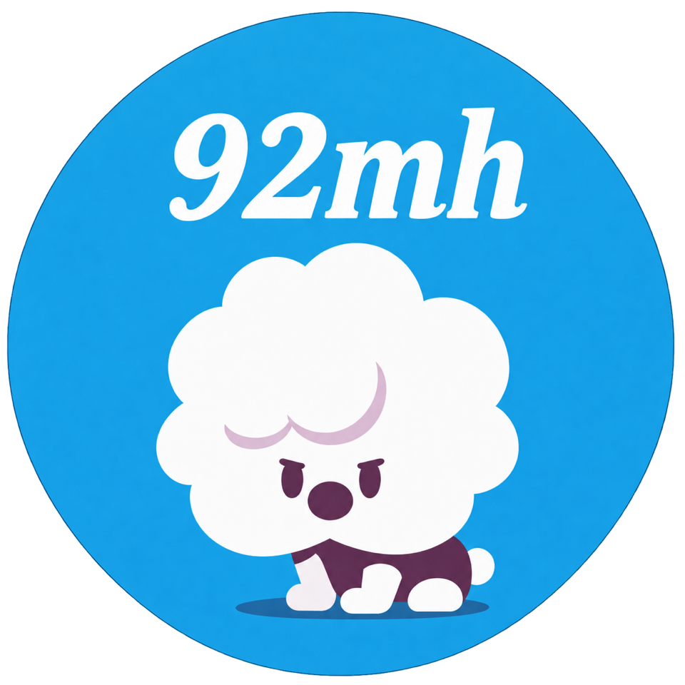
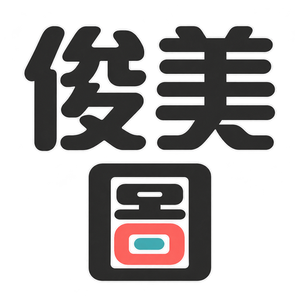
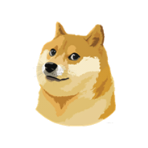
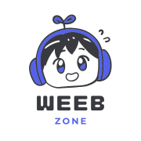

# 书源目录

本目录收录 Koma 的全部书源。每个子目录是一个独立的 Rust/WASM 源，源 ID、名称、版本与描述由 `SOURCE_INFO` 常量定义（多数在 `src/lib.rs`；kiutaku/xiutaku 共用 `sources/taku_gallery.rs`，simplyhentai-zh 用 `INFO_JSON` 常量），`metadata.json` 承载登录、章节顺序等运行时元数据。构建入口是仓库根的 `build.sh`，CI 会编译全部源并逐个校验元数据后打包发布。

下表按类别列出全部源，各类别按名称排序。"备注"来自各源 `SOURCE_INFO.description` 与 README，标注了内容分级、登录要求、收录边界等需要留意的点。

## 官方 IP / 游戏漫画

| 图标 | 目录 | 名称 | 备注 |
|---|---|---|---|
|  | bh3 | 崩坏3 IP站 | 《崩坏3》IP站的官方漫画，按独立故事篇章收录。 |
|  | fgo-zh | 从漫画了解！Fate/Grand Order | 仅收录第一系列 |
|  | huanta-zh | 幻塔官方中文漫画 | 每篇保留完整原图，评级未确认 |
|  | bns-zh-hant | 劍靈官方繁中漫畫 | 官方站繁中漫画阅读单元 |
|  | soc-zh | 铃兰之剑中文・官方漫画 | TapTap 发布，单作品分级未确认 |
|  | magireco-zh | 魔法纪录官方漫画 | 第一季漫画，来自官方站 |
|  | protectors-zh | 那些需要守护的中文・官方漫画 | 收录 5 篇有官方发布标记的漫画 |
|  | majsoul-zh | 雀魂官方漫画 | 每条官方记录一张原图 |
|  | digimonweb-zh | 数码宝贝官网 | 数码宝贝官网公开的中文漫画 |
|  | terrahistoricus | 泰拉记事社 | 泰拉记事社 — 明日方舟官方漫画平台 |
|  | honorofkings-zh | 王者荣耀世界观漫画 | 官网世界观体验站，保留原作者 |
|  | bluearchive-zh | 蔚蓝档案官方漫画 | Yostar 官方四格漫画 |
|  | onmyoji-zh | 阴阳师漫画屋 | 官方栏目与同人作者作品 |
|  | lol-zh | 英雄联盟官方漫画 | 六个已核对系列；原站图片合同变更须重审 |
|  | genshin-zh | 原神官方漫画 | miHoYo 官网公开中文漫画 |
|  | pgr-zh | 战双帕弥什官方漫画 | 保留接口实际作者字段 |
|  | dota2-zh | DOTA2官方漫画 | 官方 DOTA2 中国站漫画 |

## 漫画平台 / 聚合站

| 图标 | 目录 | 名称 | 备注 |
|---|---|---|---|
|  | comicaction-ja | webアクション | 双叶社官方连载、短篇与限时活动；公开话复用 GigaViewer 随包瓦片还原，付费话保留锁定。 |
|  | magcomi-ja | MAGCOMI | MAG Garden 官方漫画，含连载、短篇、漫画奖与题材合集；遵循匿名公开范围。 |
|  | comictrail-ja | Comic Trail | 芳文社官方漫画，按连载中、完结、短篇整理；锁定话保留限制。 |
|  | kuragebunch-ja | くらげバンチ | 新潮社官方连载、短篇与 KANATA；提供原站题材筛选，付费话保留锁定。 |
|  | mangapill-en | Mangapill | 英语漫画、短篇、同人及英语原创作品；完整题材多选、类型和状态筛选，原站已停止收录韩漫。 |
|  | nicovideoseiga-ja | ニコニコ漫画 | 日本出版社官方连载与用户投稿；只读公开话，锁定/收费/下架话保留限制。 |
|  | mangataro-en | MangaTaro | 英语日漫、韩漫和国漫；按题材、类型、连载状态分类，正文不含小说。 |
|  | jiuermanhua | 92漫画 | 92漫画收录连载分话、单行本及其他分组作品，书目按少年、少女、青年等读者分类整理。 |
|  | ikmmh-zh | 爱看漫 | 爱看漫的中文漫画连载，按站内分类组织；部分地区受原站访问限制。 |
|  | baozimh | 包子漫画 | 收录国漫及日本、韩国、欧美漫画，按地区、题材和连载状态分类。 |
|  | bikamanhua | 哔咔漫画（同名站） | bikamanhua.com 的漫画书库，按题材、人气与更新整理作品。这是同名网页站，与 Picacomic 账号服务不同。 |
|  | bilimanga | 哔哩漫画 | 哔哩漫画（bilimanga.net）收录日本、韩国、港台、欧美与大陆漫画，涵盖奇幻冒险、校园恋爱及悬疑惊悚等题材。 |
|  | dongmanmanhua | 咚漫 | 咚漫的简体中文连载漫画，按星期安排更新。本源阅读范围限原站公开章节。 |
|  | dm5 | 动漫屋 | 动漫屋（DM5）的原创漫画与日本漫画，涵盖热血、冒险、奇幻及恋爱等题材。付费章节依原站权限开放。 |
|  | acgn | 動漫戲說 | 动漫戏说收录连载漫画、单行本与画集，题材包含冒险、科幻、恋爱及推理。 |
|  | dumanwu | 读漫屋 | 读漫屋收录都市、玄幻、冒险、恋爱及古风等题材漫画，书库包含连载与完结作品。 |
|  | guazimanhua | 瓜子漫画 | 提供国漫连载，设有玄幻、都市、恋爱和古风等分类。 |
|  | happymh | 嗨皮漫画 | 当前订阅标为暂不可用 |
|  | kanman | 看漫画 | 看漫画收录热血、冒险、玄幻、恋爱及古风等题材的连载作品。可读免费章节，付费锁定章节保留原站标记。 |
|  | copymanga | 拷贝漫画 | 拷贝漫画的繁体中文漫画书库，保留各作品原站分组的分话目录，可切换简体显示书目文字。 |
|  | kuaikan | 快看漫画 | 快看的国漫、韩漫与日漫，涵盖恋爱、古风、奇幻、悬疑及热血等题材。正文限免费章节，付费与会员内容请在原站使用。 |
|  | sixmh | 六漫画 | 六漫画的中文连载漫画，包含《全职法师》等作品，按分话目录收录。 |
|  | manben | 漫本 | 漫本收录港台、日韩、大陆及欧美漫画，包含搞笑、奇幻、热血、科幻与恋爱等题材，并区分少年、少女及青年向作品。 |
|  | mh160 | 漫画160 | 漫画160的国漫与日漫连载，包含《斗破苍穹》《海贼王》等作品。 |
|  | mh1234 | 漫画1234 | 漫画1234收录国漫、日漫、韩漫、欧美及同人漫画，包含热血冒险、恋爱日常与四格等作品。 |
|  | manhuagui | 漫画柜 | 收录国产、日韩及欧美漫画的中文漫画站。本源使用普通公开目录，不包含隐藏目录。 |
|  | manhuaren | 漫画人 | 漫画人的漫画连载与单行本。部分章节需付费，部分作品受原站访问限制。 |
|  | manhuashe | 漫画社 | 漫画社收录热血、玄幻、都市与冒险等题材漫画，兼有连载及完结作品。 |
|  | manhuawu | 漫画屋 | 漫画屋收录日本、港台、韩国及欧美漫画，包含连载与完结作品。 |
|  | mangaxiaosi-zh | 漫小肆 | 漫小肆的成人韩漫与都市漫画，按作品分话连载，并按题材、地区及进度分类。 |
|  | miaoqu | 喵趣漫画 | 与六漫画共享目录 |
|  | nnhanman-zh | 鸟鸟韩漫 | 鸟鸟韩漫的中文成人韩漫，按分话连载收录，设有原站排行榜。 |
|  | rumanhua | 如漫画 | 如漫画收录都市、玄幻、冒险、恋爱、穿越与古风等题材，兼有连载及完结漫画。 |
|  | cartoon18-zh | 色漫网 | 成人漫画站Cartoon18（色漫网）。可选择简体或繁体网站界面，漫画保留作品原语言。 |
|  | tencentcomics | 腾讯动漫 | 腾讯动漫的在线漫画，包含国漫连载。本源仅提供原站明确标为免费的章节。 |
|  | woaimanhua | 我爱漫画 | 我爱漫画收录国漫、日漫、韩漫及欧美漫画，包含恋爱、校园、古风、奇幻等题材。付费章节保留锁定状态。 |
|  | comicabc | 无限动漫 | 無限動漫（8comic）的连载漫画栏目。本源只收录漫画，动画内容不在范围内。 |
|  | manhuadui | 优酷漫画 | 优酷漫画的中文连载漫画，保留同一作品的不同版本。本源提供原站公开免费章节。 |
|  | zaimanhua | 再漫画 | 再漫画收录日韩、港台、大陆及欧美漫画，涵盖冒险、恋爱与科幻等题材。部分章节受原站账号或等级限制。 |
|  | comicfury-zh | Comic Fury | 由创作者自行发布网络漫画的平台。本源选择中文作品，并可选择显示作者随页附言。 |
|  | dbmultiverse-zh | DB Multiverse | 以《龙珠Z》为基础的网络漫画，本源连接官网中文入口；部分章节保留外文对白。 |
|  | globalcomix-zh-hans | GlobalComix | GlobalComix 汇集出版社与独立创作者的数字漫画，此入口选取中文内容。正文限原站开放的免费页面。 |
|  | goda | GoDa漫画 | G站漫画的中文连载作品，涵盖玄幻、言情、都市等站内分类。 |
|  | komiic | Komiic | 中文漫画站，提供分话、分卷目录及读者、AI 推荐榜。图片访问有站点额度限制，可在源设置中登录账号。 |
|  | webtoons_zh_hant | LINE WEBTOON（繁体中文） | LINE WEBTOON 的繁体中文漫画，包含 Originals 连载与 CANVAS 创作者作品，阅读范围以此语言入口公开的章节为准。 |
|  | mangapluscreators-en | MANGA Plus Creators | 集英社官方英文创作者目录 |
|  | mangaball-zh | MangaBall | MangaBall 的中文章节书库，同一作品可能有不同翻译组发布的章节。收录范围以章节语言为准，书名不一定是中文。 |
|  | mangabz | MangaBz | Mangabz 的漫画书库涵盖热血、校园、冒险、恋爱及科幻，兼有分话与卷本；书目文字可切换简繁显示。 |
|  | mangadex | MangaDex | 收录多语言版本的漫画平台。本源可选择章节语言，默认英语；外站阅读章节不在范围内。 |
|  | mangadex-zh-hant | MangaDex（繁体中文） | MangaDex站内标记为繁体中文的漫画章节版本。只收录站内托管章节，不包含外站阅读链接。 |
|  | mangadex-zh-hans | MangaDex（简体中文） | MangaDex站内标记为简体中文的漫画章节版本。只收录站内托管章节，不包含外站阅读链接。 |
|  | mycomic | MYCOMIC | MYCOMIC 收录日漫、韩漫、国漫与欧美漫画的中文版本，兼有分话、卷本与番外；书目界面可选简体或繁体中文。 |
|  | namicomi-zh-hant | NamiComi（繁体中文） | NamiComi 是漫画创作者发表作品的平台，此入口收录繁体中文章节。正文限匿名开放内容，显示锁定章节不代表已取得付费权限。 |
|  | namicomi-zh-hans | NamiComi（简体中文） | NamiComi 是漫画创作者发表作品的平台，此入口收录简体中文章节。正文限匿名开放内容，显示锁定章节不代表已取得付费权限。 |
|  | tapastic | Tapas | Tapas 的英文漫画连载，包含平台与创作者社区作品。此入口不含小说，付费章节与排期限制依原站状态。 |
|  | utifa | Utifa | Utifa 的中文漫画书库，包含《龙珠完全版》《魔导少年》等卷本作品；此入口不含同站小说与影音内容。 |
|  | webtoons | WEBTOON（英语） | 英文 WEBTOON 与 CANVAS 浏览、搜索、阅读 |
|  | xcomic-zh-hant | XCOMIC（繁体中文） | 漫画与译本平台XCOMIC。本源收录公开的繁体中文章节，保留同作品的不同发布版本。 |
|  | xcomic-zh | XCOMIC（中文） | 漫画与译本平台XCOMIC。本源收录公开的简体中文章节，保留同作品的不同发布版本。 |
|  | zerobyw | zero搬运网 | Zero搬运网的漫画资源，包含中文翻译与机翻版本；部分章节需登录或VIP权限。 |

## 成人内容源

| 图标 | 目录 | 名称 | 备注 |
|---|---|---|---|
|  | everiaclub | Everia.club | 日本写真杂志、韩国和泰国写真、华人写真和角色扮演，支持整册多页合并。 |
|  | misskon | MissKon | 亚洲写真图集，提供浏览量榜单、分类与标签，合并原站公开相册子页。 |
|  | foamgirl | FoamGirl | 亚洲写真与角色扮演图集，支持官网分类、标签和搜索，按整册合并公开相册子页。 |
|  | meitulu | 美图录 | 真人写真，标记 NSFW；按模特、机构、标签归档，完整合并套图分页。 |
|  | junmeitu | 俊美图 | NSFW 真人写真，按模特、机构和主题归档；同套图全部分页合为一章。 |
|  | jjcos | JJCOS | 角色扮演图集与日韩写真，按分类和标签浏览公开相册。 |
|  | fourkhd | 4KHD | 韩国杂志与摄影机构写真、华人写真和角色扮演，读取原站相册大图。 |
|  | idolgravureprincessdate | Idol.gravureprincess.date | 日本偶像和声优的旧刊写真档案，可按团体及杂志标签查找。 |
|  | 3hentai-zh | 3Hentai | 3Hentai 的中文漫画图集，标示作者、社团、角色与题材标签，每册图集可连续阅读。 |
|  | jiulingmanhua | 90漫画网 | 90漫画网收录日本、韩国、国漫、港台及欧美漫画，题材包含恋爱、校园、冒险与科幻，兼有连载及完结作品。 |
|  | yiqiqimanhua | 177漫画 | 177漫画收录中文与日文成人漫画、全彩 CG 图集，包含纯图无字画集；每篇图集整册阅读。 |
|  | bakamh | 巴卡漫画 | 需 Koma 1.6.1；已通过237阅读、跨章及整章下载验收 |
|  | picacomic | 哔咔漫画 | 哔咔漫画的分集漫画书库，以站内分类、题材标签及人气榜整理作品。浏览与阅读均需登录 Picacomic 账号。 |
|  | budingmanhua | 布丁漫画 | 布丁漫画收录国漫、日漫与韩漫，题材包含恋爱、校园、玄幻、热血与日常生活。 |
|  | jisumanhua | 极速漫画 | 极速漫画的原创与日本漫画，包含热血冒险、奇幻、恋爱及校园等题材；原站锁定或下架章节依其状态保留。 |
|  | jinmantiantang | 禁漫天堂 | 禁漫天堂（JM）的漫画与分集图集，按站内分类及标签整理。此入口提供匿名公开内容，账号收藏与签到请在原站使用。 |
|  | longjm | 龙禁漫 | 中文成人连载漫画，设有新书、最近更新、热搜和周、月排行榜。 |
|  | dogemanga | 漫画狗 | 漫画狗收录分话连载与单行本，同一作品可有多个版本；分话与卷本各自保留原站目录。 |
|  | manhuamanga | 漫画manga | 漫画manga（mh03.com）的中文漫画书库，收录《一人之下》等分话连载，并按题材整理连载及完结作品。 |
|  | manwamanhua | 漫蛙漫画 | 漫蛙收录韩漫、日漫、国漫与台漫，设有一般向、BL、GL 及 TL 等作品分类。 |
|  | ikanmh | 漫小肆韩漫 | 漫小肆韩漫的漫画书库，地区分类包含韩国、日本与台湾，作品依题材及连载进度整理。 |
|  | mikagogo | 米卡插画 | 米卡插画收录插画、画师图集、画册、壁纸与 COSPLAY 相册。此入口阅读公开图集，会员或积分下载的高清文件由原站提供。 |
|  | relamanhua | 热辣漫画 | 热辣漫画收录恋爱、冒险、奇幻、校园等题材。普通浏览为免费作品，搜索亦可能列出付费作品，其锁定预览不等于完整正文。 |
|  | roumanwu | 肉漫屋 | 肉漫屋收录韩国漫画，包含剧情、现代奇幻等分类，兼有连载与完结作品。 |
|  | hentaiclub | 绅士会所 | 绅士俱乐部的漫画图集，按题材标签整理，并分为 R-15 与 R-18 分类；每部图集整册阅读。 |
|  | wnacg | 紳士漫畫 | WNACG 收录同人志、单行本、CG 与写真／Cosplay 图集，包含中文、日文及英文分类。部分内容需在原站登录。 |
|  | xipimanhua | 嬉皮漫画 | 嬉皮漫画的韩漫、国漫与日漫书库，涵盖穿越、玄幻、复仇、冒险与武侠等题材。 |
|  | xsnvshen | 秀色女神 | 秀色女神的模特写真相册，可按模特、服饰、风格、地区与拍摄机构寻找图集。 |
|  | asmhentai-zh | AsmHentai | 成人漫画与同人志图集站。本源按站内中文标记筛选作品，可按标签查找。 |
|  | buondua | Buon Dua | 公开相册，含成人内容 |
|  | cosplaytele | CosplayTele | 公开相册，含成人内容 |
|  | hcomic-zh | H-Comic | 中文成人漫画图集，包含全彩作品；可按标签挑选，或浏览随机目录。 |
|  | hanman18 | HANMAN18 | 成人漫画站HANMAN18，收录分话连载的作品，也有真人漫画。 |
|  | hentaifox-zh | HentaiFox | 中文成人漫画与同人志。榜单和随机结果可含其他语言，收藏需原站登录。 |
|  | hentaihand-zh | HentaiHand | 按单册图集收录的中文成人漫画。可按标签筛选作品，区分热门与最近上传。 |
|  | kiutaku | Kiutaku | Kiutaku 的多语言图集，包含成人内容；每册按原站页次编排，标签与相关图集可协助寻找相近作品。 |
|  | nhentaito-zh | NHentai.to | NHentai.to 的中文漫画图集，作品标示作者与题材标签，每册图集作为一部完整作品阅读。 |
|  | nhentaixxx-zh | NHentai.xxx | NHentai.xxx 的中文漫画图集，作品标示作者与题材标签，每册图集作为一部完整作品阅读。 |
|  | noyacg | NoyAcg | NoyAcg 是漫画与同人志社区，书目分全年龄、成人及综合范围。受保护内容需要在原站登录，是否可读依网站与账号状态而定。 |
|  | simplyhentai-zh | Simply Hentai | 以单册图集收录的成人漫画站。本源选择中文作品，搜索可排除指定标签。 |
|  | tibiucomics | TIBIU漫画 | TIBIU 的 BL 向漫画书库，收录连载及完结作品，阅读范围限原站公开章节。 |
|  | xiutaku | Xiutaku | Xiutaku 的多语言图集，包含成人内容；各册保留题材标签、发布日期与原站分页编排。 |

## 作者专栏 / 独立站点

| 图标 | 目录 | 名称 | 备注 |
|---|---|---|---|
|  | weicomic-ronshaonien | 創漫繁中・隆少年 | ULTIMATE 原创繁中漫画 |
|  | fjumonkey-zh-hant | 輔大猴・四格漫畫 | 作者部落格四格，依原栏目分页 |
|  | namepara-zh-hant | 菇菇官方四格漫畫 | namepara 官方繁中四格 |
|  | scitechvista-zh-hant | 科技大觀園・科普漫畫大賽 | 科普漫画大赛作品 |
|  | oldmasterq-zh-hant | 老夫子繁中・授權關聯站 | 独立运营的繁中条漫 |
|  | people2-marked-zh-hant | 人2 漫畫標記圖文 | 仅收录作者明确标记为漫画的图文 |
|  | hko-weather-family-zh-hant | 天氣家族漫畫廊・精選六期 | 港天文台《談天說地》，第77–82期 |
|  | immark-zh-hant | 我是馬克・圖文並靠《今周刊》 | 作者部落格图文 |
|  | laya-zh-hant | 醫院也瘋狂 | 雷亞醫師與兩元老師的精選藝廊 |
|  | mixflavor-life-zh-hant | 綜合口味・生活小漫畫 | 依原分类分页，不收开箱/食文 |
|  | tipo-ipmini-zh-hant | IP手札mini! 官方直達專欄 | 仅收录可直达专栏的作品 |
|  | pixiv-zh | pixiv | pixiv 创作者公开发表的全年龄漫画，包含独立作品与系列。此入口不收录成人、私人或仅限登录可见的作品，正文语言不限中文。 |
|  | xkcd-zh | xkcd | 围绕数学、语言和讽刺幽默的xkcd中文译作。本源不收录互动及动画作品。 |

## API / 杂志 / 视频类

| 图标 | 目录 | 名称 | 备注 |
|---|---|---|---|
|  | internetarchive | Internet Archive | 互联网档案馆的公开扫描件，包括绘本、历史杂志、老漫画和艺术画册。 |
|  | iqiyi | 爱奇艺叭嗒 | 爱奇艺叭嗒的漫画频道，包含恋爱、奇幻、悬疑与冒险等题材。付费章节仍需原站授权。 |
|  | tongli | 東立 | 東立电子书的漫画书库，按卷册与连载话数收录；部分内容需付费或受地区限制。 |
|  | zazhimi | 杂志迷 | 日本时尚杂志阅读来源，涵盖服饰、美妆、美发与居家生活等分类，按刊物期号收录。 |
|  | cmanhua | CManhua | CManhua 的中文连载漫画书库，包含欧美漫画；长篇作品保留原站分段编排的目录。 |

## 韩文、日文及多语言原站

| 图标 | 目录 | 名称 | 备注 |
|---|---|---|---|
|  | navercomic-ko | Naver Webtoon | Naver 韩国官方条漫，涵盖按星期连载的正式作品与两级创作者投稿。 |
|  | peppercarrot | Pepper&Carrot | David Revoy 的多语言开放版权奇幻漫画，另有短篇和 11 个官方艺术档案。 |
|  | shonenjumpplus-ja | 少年ジャンプ＋ | 集英社官方日文连载和短篇，正文限匿名公开话。 |
|  | tonarinoyoungjump-ja | となりのヤングジャンプ | 集英社连载、短篇和客串刊载，支持公开话及 GigaViewer 去扰。 |
|  | comicdays-ja | コミックDAYS | 讲谈社连载、排行、限免和杂志分话，支持公开话及 GigaViewer 去扰。 |
|  | sundaywebevery-ja | サンデーうぇぶり | 小学馆《名侦探柯南》等连载、短篇和夜 Sunday 公开话。 |
|  | ganganonline-ja | ガンガンONLINE | Square Enix 官方漫画杂志，含连载、完结、Gangan pixiv 和 GA，公开话可匿名阅读。 |
|  | kadocomi-ja | カドコミ | 角川多个漫画厂牌的连载与公开话，包内还原官网正文图。 |
|  | magazinepocket-ja | マガポケ | 讲谈社官方连载及平台原创，阅读限官网公开话，包内还原像素顺序。 |
|  | twi4-ja | Twi4 | 星海社「最前線」的日文四格连载，收录《トモちゃんは女の子！》等作品。 |

## 英文原站

| 图标 | 目录 | 名称 | 备注 |
|---|---|---|---|
|  | globalcomix-en | GlobalComix | 收录出版社与独立创作者的英文数字漫画，正文限原站公开的免费页。 |
|  | namicomi-en | NamiComi | 原创漫画平台的英文目录，正文限匿名可读章节。 |
|  | dynasty-en | Dynasty Scans | 英文系列、选集、刊物及同人志，支持作者和标签筛选，含成人内容。 |
|  | weebcentral-en | Weeb Central | 汇集英文日漫、韩漫和华语漫画，包括《王者天下》等长篇连载。 |
|  | xkcd-en | xkcd | 兰德尔·门罗的英文原作，可按单本、年份或年月浏览。 |
|  | comicfury-en | Comic Fury (English) | 创作者自行发布的英文网漫，部分作品有作者附言。 |
|  | smbc-en | Saturday Morning Breakfast Comics | 扎克·韦纳史密斯的英文科普与生活短篇漫画，部分有红按钮彩蛋。 |
|  | questionablecontent-en | Questionable Content | Jeph Jacques 自 2003 年连载的英文网漫，收录官方漫画归档，可显示作者附注。 |
|  | commitstrip-en | CommitStrip | 程序员日常英文短漫，支持官网英文搜索及年度归档。 |

## 法语及西班牙语原站

| 图标 | ID | 名称 | 说明 |
|------|----|------|------|
|  | aralosbd-fr | AralosBD | 法语原创与翻译漫画，按原站标签筛选，可阅读公开章节。 |
|  | leercapitulo-es | LeerCapitulo | 西班牙语漫画站，提供类型、题材、主题与连载状态筛选。 |

## 俄语原站

| 图标 | 目录 | 名称 | 备注 |
|---|---|---|---|
|  | acomics-ru | AComics | 俄语独立网漫平台，刊登原创连载和译作。 |

## 非源目录（不参与构建）

| 目录 | 说明 |
|---|---|
| example-demo | 教学演示源，用 JSONPlaceholder API，非真实漫画源 |
| gigaviewer.rs | GigaViewer GraphQL、产品目录和公开阅读协议共享模块 |
| gigaviewer_browse.rs | GigaViewer 连载分组、题材筛选和栏目分页共享模块 |
| wp_gallery.rs | WordPress 写真源共用的 REST 作品字段、翻页和图片提取 |
| photo_gallery.rs | 写真文章到 Koma 单册、章节和页表的共同映射 |
| taku_gallery.rs | 单文件参考实现，非标准源目录结构 |
| xcomic_java_regex.rs | 单文件参考实现，非标准源目录结构 |

## 需注意

- **繁中源**：目录名带 `-zh-hant` 后缀的是繁体中文源，`-zh-hans` 是简体，`-zh` 默认简中。
- **登录要求**：`picacomic`（账号登录）、`wnacg`（部分内容）、`tapastic`（源 web 会话）等需要凭据，其余多为匿名可读。
- **内容分级**：成人源已单独归类；标注"分级未确认/以实际内容为准"的源，单作品分级以站点实际内容为准，源级不做强保证。
- **版本**：各源在 `SOURCE_INFO`（或 `Cargo.toml`）中独立维护版本号，发布由 CI 统一打包为 `sources-<sha>` 标签，不要求跨源版本一致。本目录表不展示版本号，避免其随迭代快速过时。
