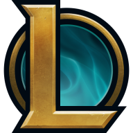
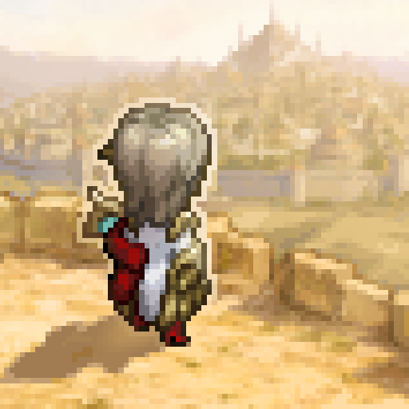
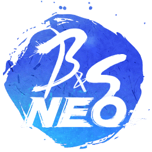
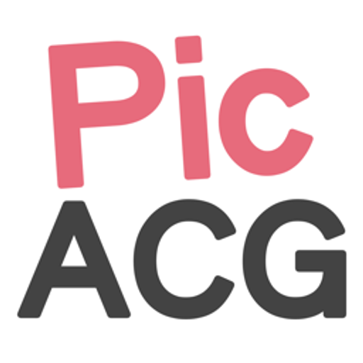
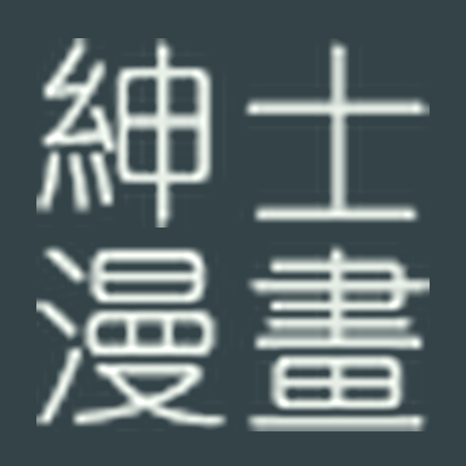

# 书源目录

本目录收录 Koma 的全部书源。每个子目录是一个独立的 Rust/WASM 源，源 ID、名称、版本与描述由 `SOURCE_INFO` 常量定义（多数在 `src/lib.rs`；kiutaku/xiutaku 共用 `sources/taku_gallery.rs`，simplyhentai-zh 用 `INFO_JSON` 常量），`metadata.json` 承载登录、章节顺序等运行时元数据。构建入口是仓库根的 `build.sh`，CI 会编译全部源并逐个校验元数据后打包发布。

下表按类别列出全部源。"备注"来自各源 `SOURCE_INFO.description` 与 README，标注了内容分级、登录要求、收录边界等需要留意的点。

## 官方 IP / 游戏漫画

| 图标 | 目录 | 名称 | 备注 |
|---|---|---|---|
|  | genshin-zh | 原神官方漫画 | miHoYo 官网公开中文漫画 |
|  | bh3 | 崩坏3 IP站 | 上游 SAFE，单作品分级未确认 |
|  | bluearchive-zh | 蔚蓝档案官方漫画 | Yostar 官方四格漫画 |
|  | magireco-zh | 魔法纪录官方漫画 | 第一季漫画，来自官方站 |
|  | majsoul-zh | 雀魂官方漫画 | 每条官方记录一张原图 |
|  | honorofkings-zh | 王者荣耀世界观漫画 | 官网世界观体验站，保留原作者 |
|  | huanta-zh | 幻塔官方中文漫画 | 每篇保留完整原图，评级未确认 |
|  | pgr-zh | 战双帕弥什官方漫画 | 保留接口实际作者字段 |
|  | lol-zh | 英雄联盟官方漫画 | 六个已核对系列；原站图片合同变更须重审 |
|  | dota2-zh | DOTA2官方漫画 | 官方 DOTA2 中国站漫画 |
|  | fgo-zh | 从漫画了解！Fate/Grand Order | 仅收录第一系列 |
|  | onmyoji-zh | 阴阳师漫画屋 | 官方栏目与同人作者作品 |
|  | soc-zh | 铃兰之剑中文・官方漫画 | TapTap 发布，单作品分级未确认 |
|  | bns-zh-hant | 劍靈官方繁中漫畫 | 官方站繁中漫画阅读单元 |
|  | protectors-zh | 那些需要守护的中文・官方漫画 | 收录 5 篇有官方发布标记的漫画 |
|  | terrahistoricus | TerraHistoricus | 泰拉记事社 — 明日方舟官方漫画平台 |

## 漫画平台 / 聚合站

| 图标 | 目录 | 名称 | 备注 |
|---|---|---|---|
|  | dm5 | DM5 | 老牌漫画平台 |
|  | tencentcomics | 腾讯动漫 | 公开目录与免费章节；付费与 JS 内容边界见 README |
|  | kuaikan | 快看漫画 | 公开目录与免费章节 |
|  | mangadex | MangaDex | 官方 API（JSON，无 HTML 抓取） |
|  | mangadex-zh-hans | MangaDex | 简体中文公开章节 |
|  | mangadex-zh-hant | MangaDex | 繁體中文目錄（zh-hk） |
|  | webtoons | WEBTOON (English) | 英文 WEBTOON 与 CANVAS 浏览、搜索、阅读 |
|  | webtoons_zh_hant | LINE WEBTOON (Traditional Chinese) | 繁中 LINE WEBTOON |
|  | tapastic | Tapas | 公开集与原站访问；登录走 Koma 源 web 会话 |
|  | mangapluscreators-en | MANGA Plus Creators by SHUEISHA | 集英社官方英文创作者目录 |
|  | namicomi-zh-hans | NamiComi | 简体中文公开漫画 |
|  | namicomi-zh-hant | NamiComi | 繁體中文公開漫畫 |
|  | globalcomix-zh-hans | GlobalComix | 中文公开漫画，可浏览目录和免费页面 |
|  | mangaxiaosi-zh | Manga Xiao Si | 有限排行与查询目录 |
|  | nnhanman-zh | NNHanman | 排行与搜索元数据 |
|  | comicfury-zh | Comic Fury | 上游 MIXED，可选作者注释 |
|  | copymanga | 拷贝漫画 | 公开列表与阅读 |
|  | mycomic | MYCOMIC | 高频迭代源 |
|  | mangabz | Mangabz |  |
|  | mangaball-zh | MangaBall | 中文章节，走 Log into the Future API |
|  | komiic | Komiic |  |
|  | dongmanmanhua | 咚漫 (DongmanManhua) | 上游 SAFE |
|  | goda | GoDa漫画 | 上游 SAFE |
|  | guazimanhua | 瓜子漫画 | 公开 HTML 源 |
|  | manhuagui | Manhuagui | 普通公开 HTML 适配，不支持成人隐藏目录 |
|  | manhuaren | 漫画人 | API 源，要求匿名会话 |
|  | manhuashe | 漫画社 (Manhuashe) |  |
|  | manhuawu | 漫画屋 (Manhuawu) | MCCMSWeb HTML 适配 |
|  | manhuadui | 优酷漫画 | 仅搜索与列表，详情与阅读不可用 |
|  | mh1234 | 漫画1234 | 公开目录与阅读 |
|  | mh160 | 漫画160 | 上游 SAFE |
|  | miaoqu | 喵趣漫画 | 与六漫画共享目录 |
|  | sixmh | 六漫画 | 公开 HTML 目录与搜索 |
|  | zaimanhua | 再漫画 | zaimanhua.com |
|  | zerobyw | Zerobyw | HTML 抓取源 |
|  | comicabc | 無限動漫 | 公开目录与有限字面记录页 |
|  | jiuermanhua | 92漫画 |  |
|  | happymh | 嗨皮漫画 |  |
|  | bilimanga | 嗶哩漫畫 | 含不同内容分级作品 |
|  | baozimh | 包子漫畫 (Baozimh) | baozimh.com HTML 抓取 |
|  | cartoon18-zh | Cartoon18 | 中文界面与匿名元数据 |
|  | utifa | Utifa | 中文漫画 |
|  | dbmultiverse-zh | Dragon Ball Multiverse | 支持文字气泡叠加 |
|  | ikmmh-zh | Ikmmh | 匿名分类目录与有限查询 |
|  | xcomic-zh | XCOMIC | 匿名查询并读取原图 |
|  | xcomic-zh-hant | XCOMIC | 繁中公开版，匿名 GraphQL 查询 |
|  | acgn | 動漫戲說 | comic.acgn.cc 公开漫画平台，含分类、搜索与列表；safe 分级 |

## 成人内容源

| 图标 | 目录 | 名称 | 备注 |
|---|---|---|---|
|  | picacomic | 哔咔漫画 | 浏览与阅读需账号登录；含 DNS 引导策略 |
|  | jinmantiantang | 禁漫天堂 | 匿名浏览与阅读，账号功能在原站使用；要求 Koma 1.4.3 |
|  | wnacg | 紳士漫畫 | 公开相册与合集，部分内容需登录 |
|  | hentaiclub | 绅士会所 | 含成人内容 |
|  | nhentaito-zh | NHentai.to | 中文漫画目录源 |
|  | nhentaixxx-zh | NHentai.xxx | 作品分级以实际内容为准 |
|  | 3hentai-zh | 3Hentai |  |
|  | asmhentai-zh | AsmHentai | 单作品评级与用量未知 |
|  | hentaifox-zh | HentaiFox | 单作品评级与用量未知 |
|  | hcomic-zh | H-Comic | 含成人内容，分级未知 |
|  | hanman18 | HANMAN18 | manga18 多源框架，NSFW |
|  | longjm | 龙禁漫 | 成人内容，单作品分级与用量未知 |
|  | buondua | Buon Dua | 公开相册，含成人内容 |
|  | cosplaytele | CosplayTele | 公开相册，含成人内容 |
|  | noyacg | NoyAcg |  |
|  | hentaihand-zh | HentaiHand | 匿名中文作品信息；含成人内容，单作品分级与用量未知 |
|  | simplyhentai-zh | Simply Hentai | 中文元数据目录；NSFW 源，单作品分级与用量未知 |
|  | kiutaku | Kiutaku | 公开图集，含成人内容；与 xiutaku 共享 `taku_gallery.rs` 实现 |
|  | xiutaku | Xiutaku | 公开图集，含成人内容；与 kiutaku 共享 `taku_gallery.rs` 实现 |

## 作者专栏 / 独立站点

| 图标 | 目录 | 名称 | 备注 |
|---|---|---|---|
|  | xkcd-zh | xkcd | 中文翻译，仅真实图像页 |
|  | hko-weather-family-zh-hant | 天氣家族漫畫廊・精選六期 | 港天文台《談天說地》，第77–82期 |
|  | oldmasterq-zh-hant | 老夫子繁中・授權關聯站 | 独立运营的繁中条漫 |
|  | weicomic-ronshaonien | 創漫繁中・隆少年 | ULTIMATE 原创繁中漫画 |
|  | fjumonkey-zh-hant | 輔大猴・四格漫畫 | 作者部落格四格，依原栏目分页 |
|  | immark-zh-hant | 我是馬克・圖文並靠《今周刊》 | 作者部落格图文 |
|  | people2-marked-zh-hant | 人2 漫畫標記圖文 | 仅收录作者明确标记为漫画的图文 |
|  | mixflavor-life-zh-hant | 綜合口味・生活小漫畫 | 依原分类分页，不收开箱/食文 |
|  | namepara-zh-hant | 菇菇官方四格漫畫 | namepara 官方繁中四格 |
|  | tipo-ipmini-zh-hant | IP手札mini! 官方直達專欄 | 仅收录可直达专栏的作品 |
|  | scitechvista-zh-hant | 科技大觀園・科普漫畫大賽 | 科普漫画大赛作品 |
|  | laya-zh-hant | 醫院也瘋狂 | 雷亞醫師與兩元老師的精選藝廊 |
|  | pixiv-zh | pixiv | 浏览与搜索漫画作品与系列 |

## API / 杂志 / 视频类

| 图标 | 目录 | 名称 | 备注 |
|---|---|---|---|
|  | tongli | 東立 | JSON API，Firebase 匿名认证 |
|  | zazhimi | 杂志迷 | JSON API 杂志源 |
|  | iqiyi | Iqiyi | Bada 公开元数据 API，需真实主机时钟与熵 |
|  | cmanhua | CManhua | 公开中文目录与章节 |

## 非源目录（不参与构建）

| 目录 | 说明 |
|---|---|
| example-demo | 教学演示源，用 JSONPlaceholder API，非真实漫画源 |
| taku_gallery.rs | 单文件参考实现，非标准源目录结构 |
| xcomic_java_regex.rs | 单文件参考实现，非标准源目录结构 |

## 需注意

- **繁中源**：目录名带 `-zh-hant` 后缀的是繁体中文源，`-zh-hans` 是简体，`-zh` 默认简中。
- **登录要求**：`picacomic`（账号登录）、`wnacg`（部分内容）、`tapastic`（源 web 会话）等需要凭据，其余多为匿名可读。
- **内容分级**：成人源已单独归类；标注"分级未确认/以实际内容为准"的源，单作品分级以站点实际内容为准，源级不做强保证。
- **版本**：各源在 `SOURCE_INFO`（或 `Cargo.toml`）中独立维护版本号，发布由 CI 统一打包为 `sources-<sha>` 标签，不要求跨源版本一致。本目录表不展示版本号，避免其随迭代快速过时。
